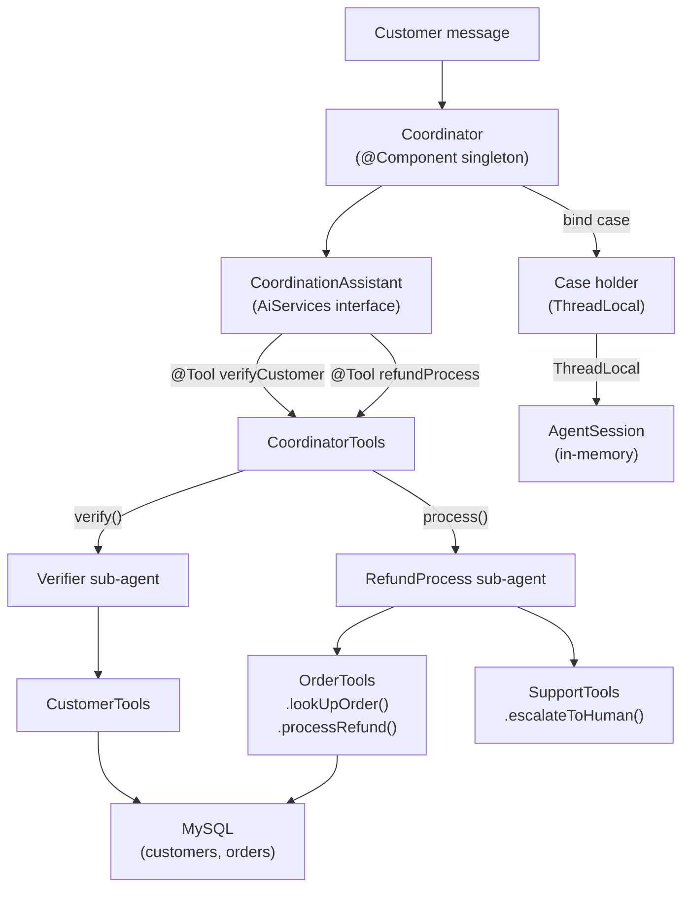

# Architecture & design rationale

This document records the design decisions behind the multi-agent customer support system. It first
summarises the common **agents-as-tools** approach it was measured against, then the limitations of
that approach and how this system addresses each, and finally the saga that executes money movements.

---

## 1. Baseline evaluated: agents-as-tools

A widely used pattern for LLM agents is *agents-as-tools*: one coordinator LLM decides which tools to
call, and some of those tools are themselves sub-agent LLMs. A minimal support assistant in that
style looks like this:

How it works:

- The coordinator is a LangChain4j `AiServices` interface with a `@SystemMessage`. The **LLM decides**
  which `@Tool` methods to call and in what order.
- Tool methods call sub-agent LLMs (a verifier, a refund processor), each its own `AiServices`
  instance. Agents never exchange messages — the coordinator dispatches tool calls sequentially.
- State is in-memory only: a `ThreadLocal`-bound case holding an `AgentSession` with per-request facts
  (verified customer, last looked-up order, refund status).
- Side effects are simulated: the refund tool returns a string and persists nothing, no status is ever
  written back, and escalation prints to stdout.

This is fine for a demo, but several properties make it unsafe for a system that moves real money.

---

## 2. Limitations of that approach, and this system's response

| Limitation of the agents-as-tools baseline | How this system addresses it |
|---|---|
| A singleton coordinator builds **one** `MessageWindowChatMemory` shared by every request, so one customer's messages leak into another's context. | Per-conversation chat memory persisted in MySQL, keyed by `@MemoryId conversationId`; a test proves two customers never share memory. |
| The **LLM owns the workflow** — it decides which tool to call next, so control flow is non-deterministic and hard to guarantee. | A deterministic Java **referee** owns the workflow via fixed `switch` rules; the LLM only understands and proposes. |
| State lives **in memory** (`ThreadLocal` + `AgentSession`), lost on restart, and tracks only one order at a time, so a second lookup overwrites the first. | State is a persistent, append-only **case board** (`case_posts`), one case per order, resumable after a crash. |
| **No real side effects** — refunds are simulated, nothing is persisted, and there is no protection against refunding twice. | Money moves only through an orchestrated **saga** with persisted log tables and idempotency keys (section 4). |
| Agent claims are trusted and guards are **ad hoc**. | Core invariant: **agents propose, Java verifies.** Every agent tool is read-only; Java recomputes facts and checks evidence on every post. |

---

## 3. Design decisions carried in

Ideas worth keeping from the baseline, re-implemented cleanly in this architecture:

| Concern | Approach in this system |
|---|---|
| Tool preconditions | Each read-only agent tool validates its preconditions before executing. |
| Automatic-refund cap | Decision-engine rule: total ≤ `support.autoLimitPaise` (default ₹5,000); over the limit escalates. |
| Ownership | Java checks the signed-in customer owns every referenced order before posting FACTS. |
| Distrust of agent claims | Agents never trigger writes; Java re-checks every claim and every `evidenceId`. |
| Typed results | Agent ports return typed records, never free-form strings. |
| Per-case isolation | A per-case lock plus the append-only board, instead of shared in-memory objects. |
| Concurrency & guardrail tests | Decision-engine unit tests, board evidence checks, and the saga concurrency test (section 4). |

---

## 4. Saga architecture

The saga is the only code that moves money. It executes the proposals the decision engine approved,
as an ordered list of steps: reversible steps first, one irreversible **pivot**, retry-only steps
after. A per-case lock serialises concurrent runs; idempotency keys are the durable backstop so a
retried, crashed, or duplicated request moves money **at most once**.

### 4.1 Steps per saga

Pattern: **Strategy** (`SagaDefinition` builds the step list per `SagaType`) driven by a template
loop (`SagaOrchestrator`).

| Saga | Step | Role | Compensation |
|---|---|---|---|
| `REFUND` | `RESERVE_CREDIT_NOTE_NUMBER` | reversible | none needed (number is deterministic) |
| `REFUND` | `CREATE_CREDIT_NOTE` | reversible | void (delete) the credit note |
| `REFUND` | `REFUND` | **pivot** (money moves) | none (irreversible) |
| `REFUND` | `NOTIFY` | retry-only (after pivot) | none |
| `COUPON_CREDIT` | `ISSUE_COUPON` | **pivot** (store credit given) | none (irreversible) |
| `COUPON_CREDIT` | `NOTIFY` | retry-only (after pivot) | none |

Failure **before** the pivot → compensate completed steps in reverse → `COMPENSATED`.
Failure **from** the pivot onward → stop, retry-only → `FAILED` (money stands).

### 4.2 Idempotency keys (all derived from `caseId`)

Deriving from `caseId` (not `sagaId`) makes concurrent duplicate requests compute identical keys, so
they collide on the unique constraints and the action happens once.

| Key | Value | Enforced by |
|---|---|---|
| refund key | `REFUND-case-<caseId>` | `refunds.idempotency_key` UNIQUE + gateway idempotency |
| credit-note number | `CN-<caseId>` | `credit_notes.credit_note_number` UNIQUE |
| coupon code | `CPN-<caseId>` | `coupons.code` UNIQUE |
| notify key | `NOTIFY-case-<caseId>` | notifier sends once per key |
| step key | `<sagaId>:<stepName>` | `saga_steps.idempotency_key` UNIQUE |

### 4.3 Saga log tables (already in `V1`; no new migration)

The log is the saga's memory: each step transition is its own committed write, so a crash leaves a
resumable record.

| Table | Columns | Purpose |
|---|---|---|
| `saga_instances` | `id, case_id, saga_type, status, started_at, ended_at` | one row per saga run; `status` ∈ `PENDING, DONE, FAILED, COMPENSATING, COMPENSATED` |
| `saga_steps` | `id, saga_id, step_name, status, idempotency_key, started_at, completed_at` | one row per step; `status` ∈ `PENDING, DONE, FAILED, COMPENSATED`; `UNIQUE (saga_id, step_name)` |

### 4.4 Concept → implementation map

| Concept | Implemented as | Name |
|---|---|---|
| Saga type | enum | `SagaType {REFUND, COUPON_CREDIT}` |
| Saga / step status | enums | `SagaStatus`, `StepStatus` |
| Saga log rows | records + JPA entities | `SagaInstance`/`SagaInstanceEntity`, `SagaStepRecord`/`SagaStepEntity` |
| One step (execute + compensate) | class | `SagaStep` |
| Step recipe per type (Strategy) | class | `SagaDefinition` |
| Engine (run / resume / compensate, per-case lock) | class | `SagaOrchestrator` |
| Decision→saga bridge | method | `CaseProcessor.runSagaIfNeeded` |
| Payment gateway (pivot) | port + fake | `PaymentGateway` / `FakePaymentGateway` |
| Coupon service (pivot) | port + fake | `CouponService` / `FakeCouponService` |
| Notifier (retry-only) | port + fake | `Notifier` / `FakeNotifier` |
| Credit-note / coupon / refund writes | ports + JPA adapters | `CreditNoteRepository`, `CouponRepository`, `RefundRepository.save` |

**Fakes, not mocks:** the external ports have working in-memory implementations (idempotent, with a
`failOn(key)` switch for failure-injection tests). Because the ports are interfaces, a real payment
provider later is just another `@Component` — the saga code is untouched.
